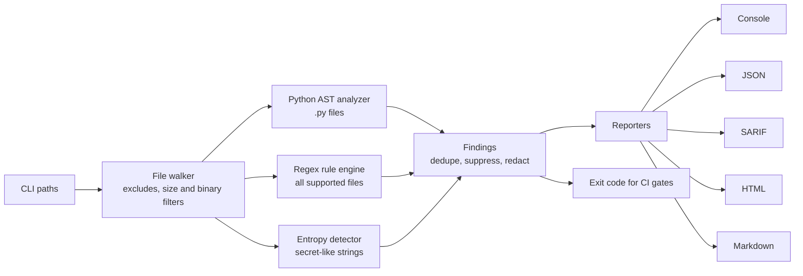

<div align="center">

# 🛡️ SecScan

### Source Code Security Scanner

**Audit your code for common security weaknesses and get a prioritised report you can review in seconds.**

[](https://github.com/YOUR_USERNAME/secscan/actions/workflows/ci.yml)


[](LICENSE)

[Quick start](#-quick-start) · [Demo](#-demo) · [Rules](#-rule-catalogue) · [CI/CD](#-cicd-integration) · [Extend it](#-write-your-own-rule) · [Limitations](#-limitations--honest-notes)

</div>

---

## ✨ Why SecScan?

Security reviews are slow when the obvious mistakes are buried in thousands of lines: a hard-coded key, a SQL query built with `+`, `verify=False` left in after debugging. **SecScan finds those quickly, explains *why* each one matters, tells you *how to fix it*, and plugs straight into CI.**

It is written in pure Python with **no third-party dependencies**, so it installs anywhere, runs in seconds, and its detection logic is small enough to read in one sitting.

## 🚀 Features

| | |
|---|---|
| 🔎 **36 rules** | Secrets, injection (SQL / OS command / code / XSS / path traversal), weak crypto, unsafe deserialization, risky configuration |
| 🧠 **Hybrid engine** | Real **AST analysis** for Python (import-alias aware) + fast line-based regex rules for JS/TS, Java, PHP, Ruby, Go and config files |
| 🔑 **Secret detection** | Known token formats (AWS, GitHub, Slack, Google), PEM keys, hard-coded credentials and a **Shannon-entropy** detector - with placeholder filtering to cut noise |
| 🙈 **Safe by design** | Secret values are **redacted in every report**, so the report itself never becomes a leak |
| 📊 **5 output formats** | Colour console, JSON, **SARIF 2.1.0** (GitHub Code Scanning), standalone **HTML** with severity filters, and Markdown |
| 🏷️ **Standards-mapped** | Every finding carries a **CWE** ID, a severity, an explanation and a concrete fix |
| 🤖 **CI-ready** | Exit codes, `--fail-on` gate, pre-commit hook, Docker image, GitHub Actions example |
| 🔇 **Low-noise controls** | Inline `# secscan: ignore=ID`, `# nosec`, `--exclude`, `--disable`, `--min-severity` |
| 🧪 **Tested & dogfooded** | 39 unit tests (CI matrix: Python 3.9-3.13), and CI makes SecScan scan **its own source** on every push |

## ⚡ Quick start

```bash
git clone https://github.com/YOUR_USERNAME/secscan.git
cd secscan
pip install .

secscan examples/vulnerable_app        # scan the bundled intentionally-vulnerable demo
secscan path/to/your/project           # scan your own code
```

No install? Run it straight from the checkout:

```bash
PYTHONPATH=src python -m secscan path/to/project
```

Or with Docker:

```bash
docker build -t secscan .
docker run --rm -v "$PWD:/src" secscan            # scans the mounted folder
```

## 🎬 Demo

Running SecScan on the bundled demo app (`examples/vulnerable_app` - fake secrets, intentionally insecure):

```text
SecScan 1.0.0 - scanned 4 file(s) in 0.01s

[CRITICAL] SEC001  AWS access key ID  (CWE-798)
    app.py:14:22
    > AWS_ACCESS_KEY_ID = "AKIA****************"
    fix: Revoke the key, rotate it, and load credentials from the environment or a secrets manager.

[CRITICAL] INJ106  File inclusion from request data (PHP)  (CWE-98)
    upload.php:7:1
    > include($_GET['page']);
    fix: Never include user-controlled paths; use an allow-list.

[HIGH] SEC006  Hard-coded credential  (CWE-798)
    Login.java:7:25
    > static final String API_TOKEN = "live*****************";
    fix: Read secrets from environment variables or a secrets manager; never commit them.

[HIGH] INJ101  SQL built with string concatenation  (CWE-89)
    Login.java:11:39
    > ResultSet r = s.executeQuery("SELECT * FROM users WHERE name = '" + user + "'");
    fix: Use parameterised queries / prepared statements.

[HIGH] DES301  Unsafe deserialization  (CWE-502)
    Login.java:14:32
    > ObjectInputStream in = new ObjectInputStream(new FileInputStream("session.bin"));
    fix: Use a data-only format such as JSON and validate the schema.

... 31 more findings ...

------------------------------------------------------------
Summary: 2 critical, 20 high, 11 medium, 3 low
critical:2  high:20  medium:11  low:3  info:0
```

📄 Full reports generated from that run: [Markdown](docs/sample-report.md) · [HTML](docs/sample-report.html) (download and open locally) · [SARIF](docs/sample-report.sarif) · [raw console output](docs/sample-output.txt)

## 🧰 Usage

```text
secscan [paths ...] [-f FORMAT] [-o FILE] [--min-severity LEVEL] [--fail-on LEVEL]
        [--exclude GLOB] [--disable IDS] [--no-color] [--list-rules] [--version]
```

| Option | Description |
|---|---|
| `paths` | Files or directories to scan (default `.`). Several paths allowed. |
| `-f, --format` | `console` (default), `json`, `sarif`, `html`, `markdown` |
| `-o, --output FILE` | Write the report to a file instead of stdout |
| `--min-severity` | Hide findings below `info`, `low`, `medium`, `high`, `critical` |
| `--fail-on` | Exit `1` if a finding at/above this level exists (default `high`, or `none`) |
| `--exclude GLOB` | Skip matching files/dirs, repeatable (`--exclude "tests/*"`) |
| `--disable IDS` | Comma-separated rule IDs to turn off (`--disable CFG404,CFG405`) |
| `--list-rules` | Print the rule catalogue |

**Exit codes:** `0` clean (or below the `--fail-on` threshold) · `1` findings at/above threshold · `2` usage error.

Skipped automatically: `.git`, `node_modules`, `venv`, `dist`, `build`, `__pycache__`, minified files, binaries and files over 1 MB.

### Examples

```bash
secscan . --min-severity medium                       # focus on what matters
secscan src -f html -o report.html                    # shareable report
secscan . -f sarif -o results.sarif --fail-on none    # for GitHub Code Scanning
secscan . --exclude "tests/*" --disable CFG404        # tune the noise
```

### Suppressing a finding

```python
password = get_password()          # nothing to suppress here
legacy = md5(data)                 # secscan: ignore=CRY201
cmd = build(cmd)  # nosec          # suppress every rule on this line
```

## 📚 Rule catalogue

| ID | Severity | CWE | Detects | Applies to | Engine |
|---|---|---|---|---|---|
| `SEC001` | Critical | [CWE-798](https://cwe.mitre.org/data/definitions/798.html) | AWS access key ID | any file | regex |
| `SEC002` | Critical | [CWE-321](https://cwe.mitre.org/data/definitions/321.html) | Private key in source | any file | regex |
| `SEC003` | Critical | [CWE-798](https://cwe.mitre.org/data/definitions/798.html) | GitHub access token | any file | regex |
| `SEC004` | High | [CWE-798](https://cwe.mitre.org/data/definitions/798.html) | Google API key | any file | regex |
| `SEC005` | High | [CWE-798](https://cwe.mitre.org/data/definitions/798.html) | Slack token | any file | regex |
| `SEC006` | High | [CWE-798](https://cwe.mitre.org/data/definitions/798.html) | Hard-coded credential | any file | regex |
| `SEC007` | Medium | [CWE-798](https://cwe.mitre.org/data/definitions/798.html) | High-entropy string (possible secret) | any file | entropy |
| `INJ101` | High | [CWE-89](https://cwe.mitre.org/data/definitions/89.html) | SQL built with string concatenation | JS/TS, Java, PHP, Ruby, Go | regex |
| `INJ102` | High | [CWE-78](https://cwe.mitre.org/data/definitions/78.html) | OS command built from dynamic input | JS/TS | regex |
| `INJ103` | High | [CWE-78](https://cwe.mitre.org/data/definitions/78.html) | Shell execution with variable (PHP) | PHP | regex |
| `INJ104` | Medium | [CWE-78](https://cwe.mitre.org/data/definitions/78.html) | Runtime.exec / sh -c execution | Java, Go, Ruby | regex |
| `INJ105` | High | [CWE-95](https://cwe.mitre.org/data/definitions/95.html) | Dynamic code evaluation | JS/TS, PHP | regex |
| `XSS101` | Medium | [CWE-79](https://cwe.mitre.org/data/definitions/79.html) | Unsafe HTML sink | JS/TS | regex |
| `XSS102` | High | [CWE-79](https://cwe.mitre.org/data/definitions/79.html) | Request data echoed without escaping (PHP) | PHP | regex |
| `INJ106` | Critical | [CWE-98](https://cwe.mitre.org/data/definitions/98.html) | File inclusion from request data (PHP) | PHP | regex |
| `INJ107` | High | [CWE-22](https://cwe.mitre.org/data/definitions/22.html) | Path traversal via request input | JS/TS | regex |
| `CRY201` | Medium | [CWE-327](https://cwe.mitre.org/data/definitions/327.html) | Weak hash algorithm (MD5/SHA-1) | JS/TS, Java, PHP, Ruby, Go | regex |
| `CRY202` | Medium | [CWE-327](https://cwe.mitre.org/data/definitions/327.html) | Weak cipher or ECB mode | all code | regex |
| `CRY203` | High | [CWE-295](https://cwe.mitre.org/data/definitions/295.html) | TLS certificate verification disabled | all code | regex |
| `CRY204` | Medium | [CWE-338](https://cwe.mitre.org/data/definitions/338.html) | Insecure randomness for a security value | all code | regex |
| `JWT301` | High | [CWE-347](https://cwe.mitre.org/data/definitions/347.html) | JWT signature validation disabled | all code | regex |
| `DES301` | High | [CWE-502](https://cwe.mitre.org/data/definitions/502.html) | Unsafe deserialization | PHP, Java, Ruby, JS/TS | regex |
| `CFG401` | Medium | [CWE-489](https://cwe.mitre.org/data/definitions/489.html) | Debug mode enabled | any file | regex |
| `CFG402` | Medium | [CWE-942](https://cwe.mitre.org/data/definitions/942.html) | Wildcard CORS / allowed hosts | any file | regex |
| `CFG403` | Medium | [CWE-732](https://cwe.mitre.org/data/definitions/732.html) | World-writable permissions | all code | regex |
| `CFG404` | Low | [CWE-319](https://cwe.mitre.org/data/definitions/319.html) | Cleartext HTTP URL | all code | regex |
| `CFG405` | Low | [CWE-668](https://cwe.mitre.org/data/definitions/668.html) | Binds to all network interfaces | all code | regex |
| `PY101` | High | [CWE-95](https://cwe.mitre.org/data/definitions/95.html) | eval()/exec() call | Python | ast |
| `PY102` | High | [CWE-78](https://cwe.mitre.org/data/definitions/78.html) | Shell command execution | Python | ast |
| `PY103` | High | [CWE-502](https://cwe.mitre.org/data/definitions/502.html) | Unsafe deserialization (pickle/marshal/shelve) | Python | ast |
| `PY104` | High | [CWE-502](https://cwe.mitre.org/data/definitions/502.html) | yaml.load without a safe loader | Python | ast |
| `PY105` | Medium | [CWE-327](https://cwe.mitre.org/data/definitions/327.html) | Weak hash (hashlib md5/sha1) | Python | ast |
| `PY106` | High | [CWE-89](https://cwe.mitre.org/data/definitions/89.html) | SQL query built from dynamic string | Python | ast |
| `PY107` | Medium | [CWE-377](https://cwe.mitre.org/data/definitions/377.html) | Insecure temporary file (mktemp) | Python | ast |
| `PY108` | High | [CWE-1336](https://cwe.mitre.org/data/definitions/1336.html) | Template injection / autoescape off | Python | ast |
| `PY109` | Low | [CWE-703](https://cwe.mitre.org/data/definitions/703.html) | Exception silently swallowed | Python | ast |

Run `secscan --list-rules` to see the same list in your terminal.

## 🏗️ How it works



**Design decisions**

- **AST for Python, regex for everything else.** The AST understands `import pickle as p; p.loads(x)` and knows `subprocess.run(..., shell=False)` is fine, which a regex cannot. Other languages get fast line-based rules gated by file extension and optional *context* patterns (e.g. `Math.random()` only matters on lines that mention a token or password).
- **Rules are data.** A rule is a small dataclass (ID, severity, CWE, description, fix, pattern). Adding detection needs no engine changes.
- **Noise control is a feature.** Comment lines are skipped for code rules, placeholders like `changeme` / `<your-key>` are ignored, and entropy hits only fire when no stronger secret rule already matched the line.
- **Reports must not leak.** Secrets are masked at the moment a finding is created, so every output format is safe to share.
- **HTML output is escaped** - scanning hostile code can't inject script into the report (covered by a test).

## 🔌 CI/CD integration

### GitHub Actions (with Code Scanning)

```yaml
name: security
on: [push, pull_request]
jobs:
  secscan:
    runs-on: ubuntu-latest
    permissions: { contents: read, security-events: write }
    steps:
      - uses: actions/checkout@v4
      - uses: actions/setup-python@v5
        with: { python-version: "3.12" }
      - run: pip install git+https://github.com/YOUR_USERNAME/secscan.git
      - run: secscan . --exclude tests --fail-on none -f sarif -o secscan.sarif
      - uses: github/codeql-action/upload-sarif@v3
        with: { sarif_file: secscan.sarif }
      - run: secscan . --exclude tests --fail-on high      # block the build on high/critical
```

### pre-commit

```yaml
repos:
  - repo: https://github.com/YOUR_USERNAME/secscan
    rev: v1.0.0
    hooks:
      - id: secscan
```

## 🧩 Write your own rule

Add one entry to `RULES` in [`src/secscan/rules.py`](src/secscan/rules.py):

```python
Rule("CRY205", "Hard-coded IV for encryption", "medium", "CWE-329",
     "A constant IV makes CBC encryption predictable.",
     "Generate a random IV per message and store it with the ciphertext.",
     category="crypto", langs=("py", "js", "java"),
     pattern=r"(?i)\biv\s*=\s*[b]?[\"'][^\"']{8,}[\"']")
```

Then add a positive and a negative test in `tests/test_scanner.py` - that's it. See [CONTRIBUTING.md](CONTRIBUTING.md).

## 📁 Project structure

```text
secscan/
├── src/secscan/
│   ├── cli.py          # argument parsing, exit codes
│   ├── scanner.py      # file walking, regex + entropy engine, suppression, redaction
│   ├── pyast.py        # Python AST visitor (alias-aware)
│   ├── rules.py        # the rule catalogue (data)
│   ├── reporters.py    # console / JSON / SARIF / HTML / Markdown
│   └── models.py       # Rule, Finding, ScanResult
├── tests/              # 39 unittest cases (rules, suppression, redaction, reporters, CLI)
├── examples/vulnerable_app/   # intentionally insecure demo (fake secrets)
├── docs/               # sample reports generated by the tool
├── .github/workflows/ci.yml   # test matrix + self-scan + SARIF upload
├── Dockerfile · pyproject.toml · .pre-commit-hooks.yaml
```

## 🧪 Testing

```bash
pip install -e .
python -m unittest discover -s tests -v
secscan src --fail-on high        # SecScan scanning itself
```

## ⚠️ Limitations & honest notes

SecScan is a fast, readable **first-pass auditor**, not a replacement for a full SAST platform.

- **Pattern-based, no data-flow / taint tracking.** It flags dangerous *shapes* (`execute(f"...")`, `eval(...)`), but cannot prove that attacker-controlled data actually reaches them. Expect some false positives and some misses.
- **Non-Python rules are line-based**, so a vulnerability split across several lines can be missed.
- **Dependency vulnerabilities (CVEs) are out of scope** - pair it with `pip-audit` / `npm audit`.
- For deep, production-grade coverage combine it with tools such as Semgrep, Bandit, CodeQL and a dedicated secret scanner. SecScan's value is being small, transparent, dependency-free and easy to extend.

## 🗺️ Roadmap

- [x] Python AST analysis with import-alias resolution
- [x] SARIF 2.1.0 + HTML + Markdown + JSON reports
- [x] Inline suppressions and secret redaction
- [ ] Project config file (`.secscan.toml`) and baseline files for legacy code
- [ ] Scan only changed files (`--since <git-ref>`)
- [ ] Basic intra-function taint tracking for Python
- [ ] C#, Kotlin and Rust rule packs
- [ ] VS Code extension (SARIF viewer integration)

## 🤝 Contributing

Rules, tests and false-positive reports are very welcome - read [CONTRIBUTING.md](CONTRIBUTING.md). To report a vulnerability in SecScan itself, see [SECURITY.md](SECURITY.md).

## ⚖️ Responsible use

Only scan code you own or have permission to review. The files in `examples/` are **deliberately insecure and contain fake credentials** for demonstration - never deploy them.

## 📄 License

[MIT](LICENSE) © 2026 Souvik Das

<div align="center">

**If SecScan helped you, give it a ⭐ - it helps others find it!**

</div>
# secscan
